<div class="cover">

<p class="kicker">IMPACT TANK ’26 · Stage 3 · Prototype / MVP submission</p>

# The Journey After Harvest: prototype v0.1.0

<p class="lede">A working research prototype for perishable produce (tomato, Nagpur orange, onion) in the Nagpur Division,
Maharashtra. It combines a quality-aware routing assistant, tested in a simulation, with a phone app that records
what happens to each lot from farm to market.</p>

| | |
|---|---|
| **Team** | [Team name] |
| **Members** | [Member 1] · [Member 2] · [Member 3] · [Member 4] · [Member 5] |
| **Institution** | [College / University] |
| **Built** | 24–26 October 2026 (git history in section 10) |
| **Product name** | "Impact Tank Post-Harvest Platform" is a working title |

<p class="note"><b>Read first.</b> Every impact number in this document is a <b>simulation output, not field-validated</b>.
In our pre-registered experiment the quality-aware policy <b>did not beat</b> the static baseline: it wasted less in
summer and monsoon but left more demand unmet in every season (section 7). Dispatcher needs have <b>not</b> yet
been checked in interviews. All people and lots in the demo are made up and are labelled DEMO on screen.</p>

</div>

## Contents of this submission

| Stage 3 asks for | Where it is |
|---|---|
| Prototype / MVP | The full source code (`phl-prototype-source.zip`, or the repository), runnable with two commands (section 9) |
| Short demonstration video | Recorded separately by the team (`VIDEO_SHOTLIST.md` has the plan) |
| User workflow or architecture | Section 3 (user workflow) and section 4 (architecture); also `workflow.svg` and `architecture.svg` |
| Core features implemented | Section 5, with screenshots of the running app |
| Known limitations | Section 8 |

## 1. The problem (recap from Rounds 1 and 2)

India loses about **19.3 million tonnes** of fruit and vegetables a year across all stages from farm to retail
(NABCONS for MoFPI, reference period 2020–22). Our brief focused on one stretch: from the assembly mandi, by road, to
the receiving market. Once a load leaves, the dispatcher cannot see heat, delays, handling or how crowded the destination
market is. No public dataset records trip-level spoilage, so nobody knows how much of that loss happens in transit.

The Round 1 solution deck picked a **simulation-led, quality-aware routing assistant** and asked one question:
*does a quality-aware routing policy reduce wastage compared with a static shortest-path route, without leaving
demand unmet?* Stage 3 is our attempt to build that and answer it honestly.

## 2. What we built

The prototype has two layers that share one data model.

- **Decision layer.** An hourly simulation of produce lots moving on the real road network of Nagpur Division, using
  replayed weather and real market arrival volumes. It compares two routing policies on identical inputs. The same
  logic powers a **Route advisor** that compares the usual route with a quality-aware option for a single load.
- **Operations layer.** An installable phone web app (PWA) for farmers, collection-centre supervisors, warehouse owners,
  dispatchers, drivers and NGOs. It registers lots with a QR label, records two-party handovers in a tamper-evident log,
  logs wastage with reasons, shows a shelf-life traffic light, a mandi crowd meter, and an NGO rescue flow for surplus.
  This layer exists because the trip-level data the simulation needs does not exist yet. The app is designed to start
  collecting it.

Everything runs locally from a clean clone with no API keys: Python/FastAPI backend, SQLite, React PWA.

## 3. User workflow

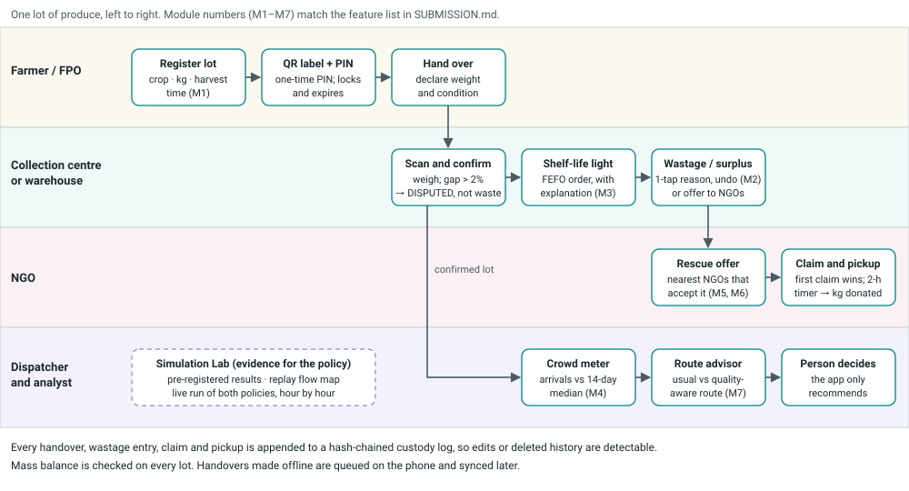

**One lot, step by step**

1. **Farmer / FPO** registers a lot (crop, kg, harvest time). The app prints a QR label and a one-time PIN.
   The PIN works only with that lot's code, locks after five wrong tries and expires.
2. **Handover.** The farmer declares weight and condition. The collection-centre supervisor scans the QR, weighs the
   lot and confirms. Both sides must act. If the weights differ by more than 2%, the lot is marked *disputed*,
   never silently booked as waste.
3. **Storage.** The warehouse or collection centre sees every lot as a green / amber / red shelf-life light, sorted
   first-expiring-first-out. *How is this calculated?* shows every input and whether it is real or assumed.
4. **Wastage or surplus.** A supervisor logs wastage with a reason in one tap, with an undo window. Produce that
   will not sell is offered to the nearest NGOs that accept that crop and have capacity.
5. **NGO rescue.** The first NGO to claim wins and gets a two-hour pickup timer. Pickup is another two-party
   handover, and the kilograms are booked as *donated*, not *wasted*.
6. **Dispatcher.** Before sending a load, the dispatcher checks the crowd meter, which compares today's arrivals with
   the market's usual 14-day median. The **Route advisor** then compares the usual route with a quality-aware option.
   The app recommends; the person decides.
7. **Analyst.** The Simulation Lab shows the pre-registered results, a map replay of both policies, and a live
   side-by-side run.

Offline: handovers made without signal are queued on the phone and synced later. Languages: English, Hindi, Marathi
(machine drafts awaiting native review).

## 4. Architecture

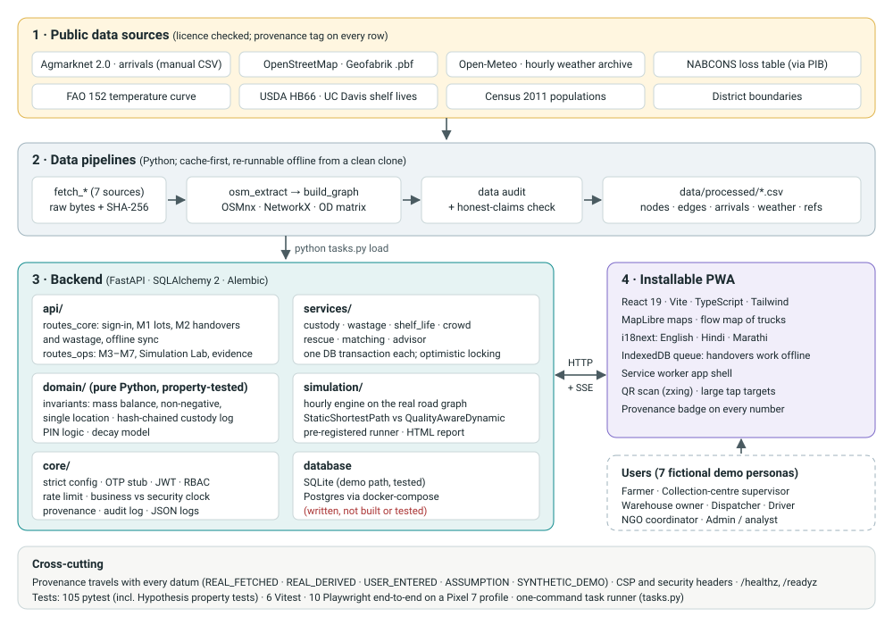

| Layer | What it does | Built with |
|---|---|---|
| Data pipelines | Fetch, checksum and clean public data; build the road graph and travel-time matrix; audit gaps | Python 3.11, pandas, OSMnx, NetworkX, pyosmium, GeoPandas |
| Domain (pure Python) | Lot and node operations, invariants (mass balance, non-negative stock, one location at a time), hash chain, PIN, decay model | Plain Python, Hypothesis property tests |
| Services and API | One database transaction per action; optimistic locking for races (e.g. two NGOs claiming at once) | FastAPI, SQLAlchemy 2, Alembic, pydantic |
| Simulation | Hourly engine on the real road graph; two policies; pre-registered runner; HTML report | NetworkX, SciPy, NumPy |
| App | Installable PWA, maps, QR scanning, offline queue, three languages | React 19, Vite, TypeScript, Tailwind, MapLibre, zxing, i18next |

**Data used, and how real it is.** Every row carries a provenance tag, and the app shows it.

| Data | Size | Provenance |
|---|---|---|
| Agmarknet market list (6 districts) | 57 markets | Real, fetched |
| Agmarknet arrivals for tomato, onion, orange (manual CSV exports; captcha is never automated) | 4,452 rows → 3,989 market-days | Real, fetched → derived |
| Road network from OpenStreetMap (Geofabrik extract) | 22,644 edges, 9,677 nodes | Real, derived (94% of speeds are road-class defaults) |
| Places: markets, cold storage, processing units, NGOs | 170 | 100 real, 69 town-centre stand-ins (assumption), 1 demo |
| Weather replay (Open-Meteo, 6 points, 1 Nov 2025 → 18 Oct 2026) | 50,688 hours | Real, fetched |
| NABCONS loss table, FAO temperature curve, USDA/UC Davis shelf lives, Census 2011 | reference tables | Real, fetched |
| Demo people and lots; simulation supply lots | n/a | Synthetic, badged DEMO everywhere |
| Thresholds, speeds, congestion, decay extrapolation | 29 assumptions (A1–A29) | Assumption, listed in `docs/ASSUMPTIONS.md` |

## 5. Core features implemented

All screens below are from the running prototype (demo data). Module numbers match section 3.

<div class="feat">

### M1 · Lot registration, QR label and two-party handover
- Short lot code, QR label and a one-time PIN (hashed, with lockout and expiry).
- Each handover needs the sender to declare and the receiver to weigh and confirm. A weight gap over 2% marks the
  lot as disputed.
- Every event is appended to a **hash-chained custody log**. Editing, deleting or truncating history is detected,
  and tests cover each of these cases.

### M2 · One-tap wastage logger
- Slider in kg, a fixed list of reasons and an undo window. Undo writes a compensating entry, so history is never deleted.
- Mass balance is checked: a lot can never lose more than it holds.

</div>

<div class="phones">
<figure>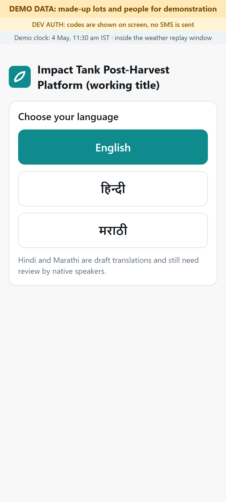<figcaption>Onboarding: language first</figcaption></figure>
<figure>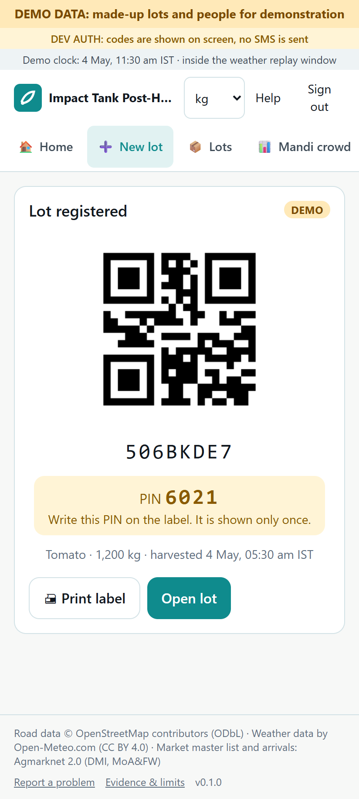<figcaption>M1: QR label and one-time PIN</figcaption></figure>
<figure><figcaption>M2: wastage logger</figcaption></figure>
<figure>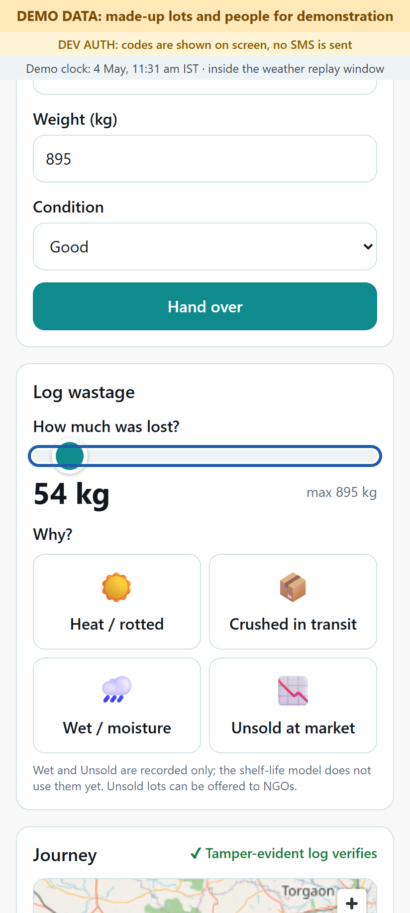<figcaption>Lot journey with a tamper-evident chain</figcaption></figure>
</div>

<div class="feat">

### M3 · Shelf-life traffic light (first-expiring-first-out)
- Remaining life comes from a sourced reference shelf life and FAO's rule that deterioration roughly doubles to
  triples for every 10 °C, using replayed hourly weather for the lot's location.
- *How is this calculated?* lists every input with its provenance and the low and high bounds. It states plainly that
  this is a model, not a food-safety certificate.

</div>

<figure>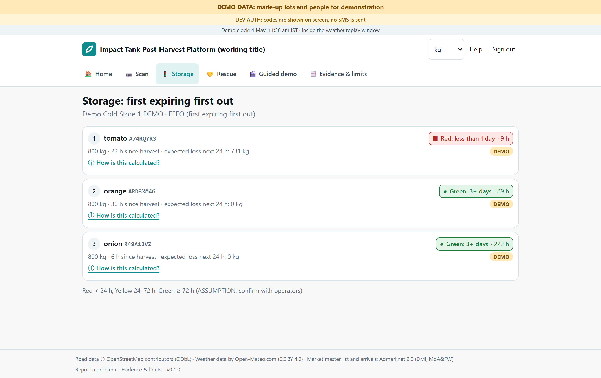<figcaption>M3: storage view, sorted first-expiring-first-out</figcaption></figure>
<figure>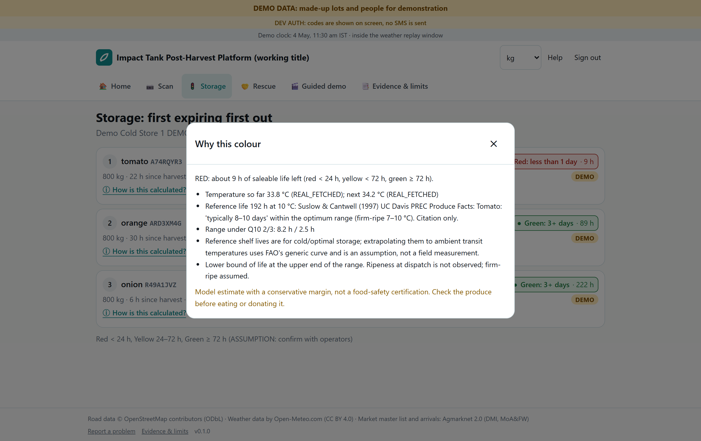<figcaption>M3: every input behind the estimate, with its provenance</figcaption></figure>

<div class="feat">

### M4 · Mandi crowd meter
- Shows today's reported arrivals divided by the market's trailing 14-day median, from Agmarknet.
- It never says "% full", because no market capacity data exists. Markets that did not report show "no data" and
  are never filled in.
- When a market is unusually busy, the app suggests nearby markets that have data, with the road time to each.

### M5 / M6 · NGO rescue and redistribution matching
- Surplus is offered in waves to the nearest suitable NGOs. Matching uses road time, remaining shelf life and capacity
  fit, and the score breakdown is shown.
- The first claim wins, enforced in the database (tested with two NGOs claiming at the same moment). The winner gets a
  two-hour pickup timer; if it expires, the offer goes to the next wave.

</div>

<figure>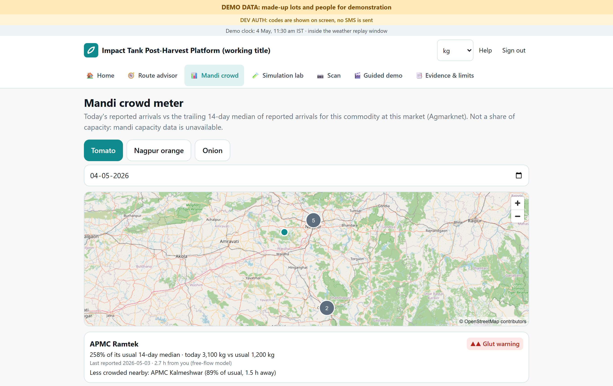<figcaption>M4: mandi crowd meter</figcaption></figure>

<div class="phones">
<figure>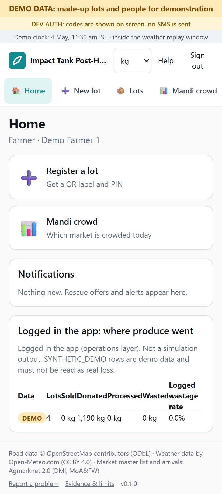<figcaption>Farmer home screen</figcaption></figure>
<figure>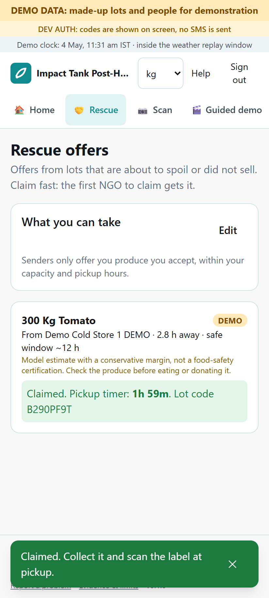<figcaption>M5: NGO claim with a pickup timer</figcaption></figure>
</div>

<div class="feat">

### M7 · Route advisor
- For one load, compares the usual static shortest route with the quality-aware option. Shows predicted quality on
  arrival with Q10 bounds, kilograms likely left, the crowd at the destination and the road on a map.
- Gives a recommendation with its reasons, for example *keep the planned market*, plus alerts. It never acts on its own.

</div>

<figure>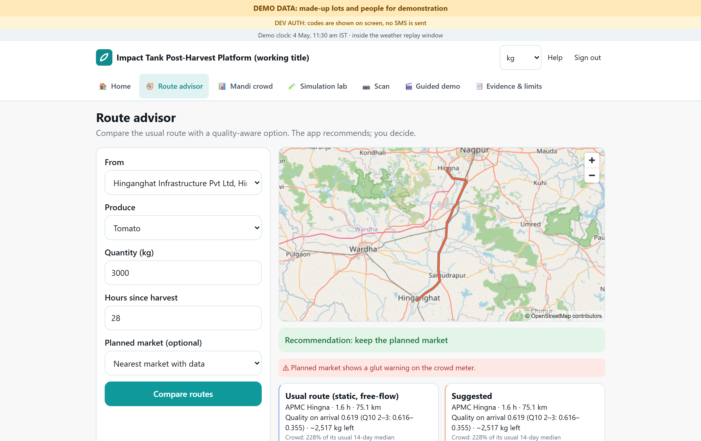<figcaption>M7: route advisor</figcaption></figure>

<div class="feat">

### Simulation Lab: pre-registered results, flow-map replay and live run
- **Pre-registered results.** Each season (summer, monsoon, winter) is run with 20 seeds. The policies get identical
  lots, weather, roads and random draws; only the routing differs. The decision rule was committed before any
  registered run (commit `5c840ce`).
- **Replay on map.** Both policies on the real map, hour by hour. Each truck is drawn with a line to its destination,
  and a *Busiest hour* button jumps to the busiest moment.
- **Live run.** Choose a start date, a number of days and a seed, and watch both policies run side by side, streamed
  from the server. Wastage, unmet demand, a cumulative chart, a map you can scrub hour by hour, and a mass-balance
  check every hour.

</div>

<figure>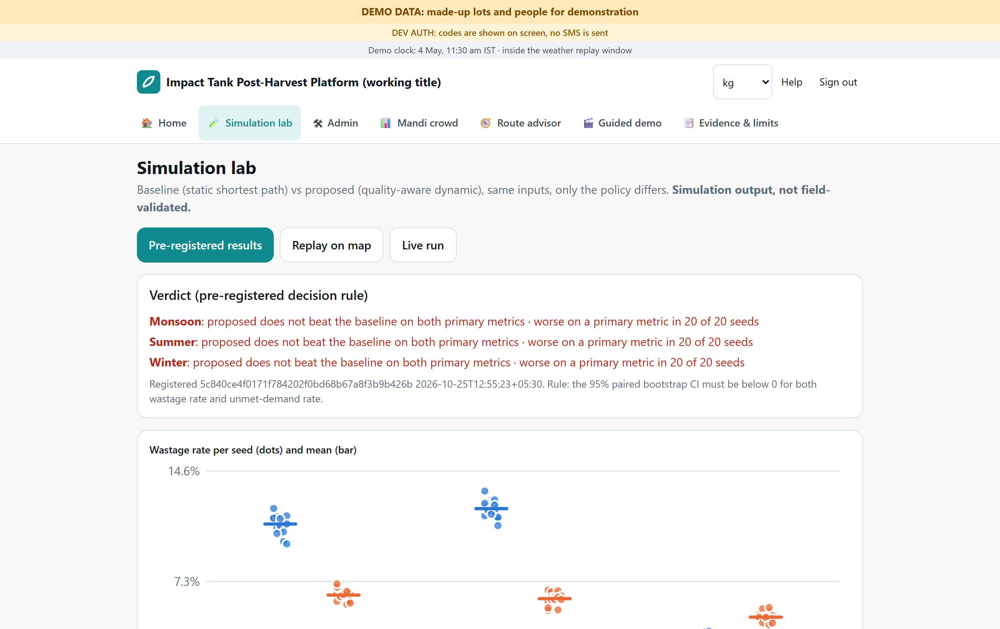<figcaption>Pre-registered results and verdict</figcaption></figure>
<figure>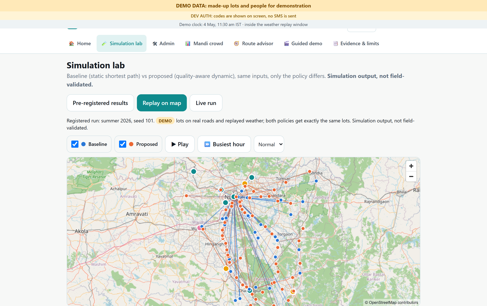<figcaption>Replay: blue = baseline trucks, orange = proposed trucks; lines point to each truck's destination</figcaption></figure>
<figure>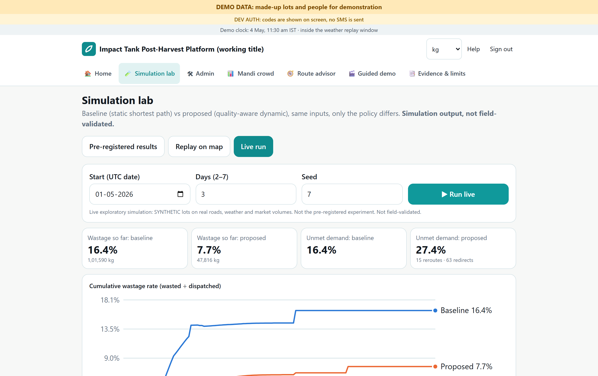<figcaption>Live run: wastage and unmet demand as the run progresses (one exploratory 3-day run, not the registered experiment)</figcaption></figure>
<figure>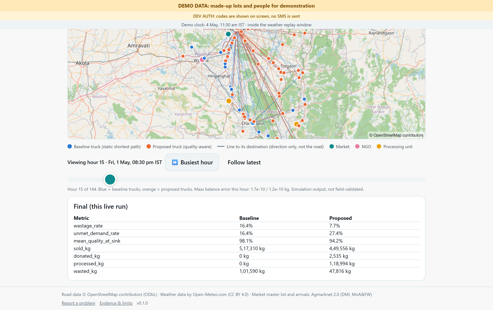<figcaption>Live run map at its busiest hour, with the final table for that run</figcaption></figure>

<div class="feat">

### Built in from the start
- **Guided demo** (`/demo`) walks through the whole story in six steps, signing in as fictional personas.
- **Evidence & limits** page: every stakeholder claim with its source and tag (documented / interpretation / hypothesis),
  and the list of limitations.
- **Provenance badges** on every number; synthetic data is always badged DEMO, and a test enforces this.
- Role-based access for seven roles, on-screen dev sign-in codes (no SMS), rate limiting, security headers, an audit
  log, health checks, and a business clock that keeps the demo inside the weather-replay window.

</div>

<figure>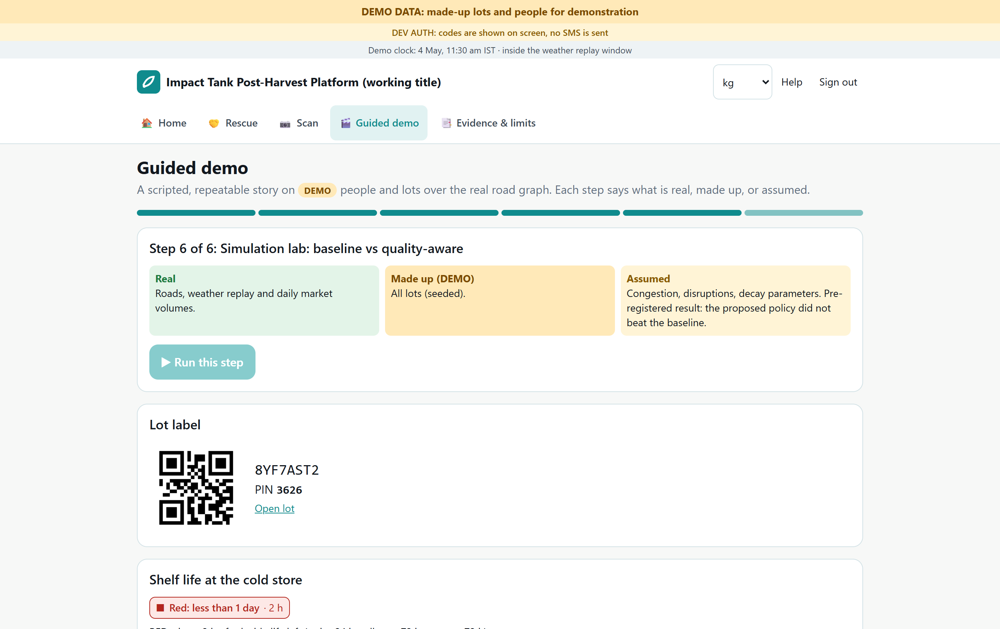<figcaption>Guided demo</figcaption></figure>
<figure>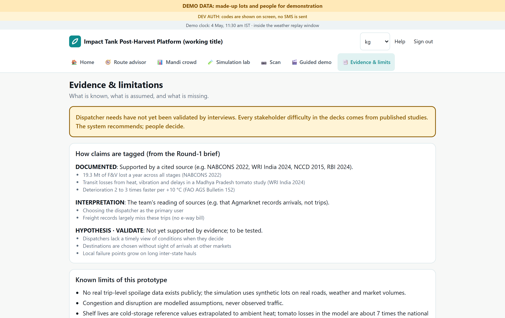<figcaption>Evidence &amp; limits page</figcaption></figure>

## 6. Quality and testing (actual results)

| Check | Result |
|---|---|
| Backend tests (pytest): unit tests; property tests for mass balance, non-negativity, the hash chain and single location; tamper detection; concurrency race; role-access matrix; PIN lockout; M3–M7; pipelines; simulation determinism | **105 passed** |
| Frontend unit tests (Vitest), including "synthetic data is always badged" | **6 passed** |
| End-to-end (Playwright, Pixel 7 profile in Chrome): onboarding for 4 roles, QR handshake, wastage and undo, two NGOs claiming at once, offline handover then sync, guided demo, evidence page | **10 passed** |
| Type checks and lint (mypy, ruff, tsc, eslint) | clean |
| Dependency audit (npm audit, pip-audit) | 0 known vulnerabilities |
| Reproducibility: registered runs re-run in a fresh process | event-log SHA-256 matches |
| Lighthouse, mobile, welcome page (localhost) | Performance 82 · Accessibility 100 · Best Practices 82 · SEO 100 |

## 7. What the simulation found

The pre-registered rule: the proposed policy "beats" the baseline only if it lowers wastage **without** raising unmet
demand, judged by a paired bootstrap over 20 seeds per season.

| Season | Wastage, baseline → proposed | Unmet demand, baseline → proposed | Verdict |
|---|---|---|---|
| Summer | 12.1% → 6.2% | 12.1% → 24.0% | does not beat baseline |
| Monsoon | 11.1% → 6.4% | 11.1% → 19.4% | does not beat baseline |
| Winter | 2.8% → 5.0% | 2.8% → 22.8% | does not beat baseline (worse on both) |

All differences are outside their 95% confidence intervals, and unmet demand is higher in all 20 seeds of every
season. **Simulation output, not field-validated.** The quality-aware policy moves produce that is at risk towards
processing units and NGOs. That cuts recorded waste but leaves markets short. Four sensitivity variants and three
post-hoc variants show the same trade-off. **We claim no reduction in loss**, and we do not use the provisional 14%
figure from earlier decks.

The useful outcome is that the routing objective must make this trade-off explicit, or leave it as the dispatcher's
choice, before anyone uses the routing in the field.

## 8. Known limitations

**Evidence and users**
- Dispatcher, supervisor and NGO needs have **not been validated by interviews**. Stakeholder difficulties come from
  published studies, and each is tagged on the Evidence page.
- There is **no real trip-level data**. The simulation runs synthetic lots on real roads, real weather and real market
  volumes.

**Model**
- **Decay levels are uncertain.** Reference shelf lives are cold-storage values extrapolated to ambient heat with FAO's
  generic curve. Simulated tomato loss (23.7%) is far above the NABCONS market-level figure (3.25%), and our own
  plausibility check flags it.
- **Congestion and disruptions are modelled assumptions**, not observed traffic, and 94% of road speeds are road-class
  defaults.
- The value weights for market, NGO and processing outcomes are assumptions, and they drive the trade-off in section 7.

**Data**
- Agmarknet arrivals come from manual exports (the site uses a captcha). Only the Nagpur and Chandrapur districts
  report the pilot crops, and orange has no arrivals from May to August.
- 21 of 57 markets are waiting for a human to review their location. Until then, town centres stand in for market yards.
- No capacity data exists for markets, cold storage or NGOs. That is why the crowd meter is relative, never "% full".
- Weather is one gridded point per district, not the temperature inside the truck. Populations are from Census 2011.

**Product**
- Sign-in is a development stub: codes are shown on screen and no SMS is sent.
- Hindi and Marathi text is machine-drafted and needs native review.
- The Postgres / Docker deployment files were written but **not built or tested**; only the SQLite path is tested.
- The rate limiter works for a single server only.

**Legal**
- The free Open-Meteo API and public OSM map tiles are for non-commercial use, which fits this research prototype.
- Road data derived from OSM is under the ODbL licence.
- Food-donation liability and data protection need review by qualified people before any pilot.

The full list is in `docs/LIMITATIONS.md`; every assumption is in `docs/ASSUMPTIONS.md`.

## 9. How to run it

Requirements: Python 3.11, Node 22, Git. No API keys and no Docker.

```
python tasks.py setup      # creates .venv from the lock file and runs npm ci (about 3.5 minutes)
python tasks.py demo       # loads committed data into SQLite and serves http://localhost:8000
```

Open **http://localhost:8000/demo** for the guided demo. Demo phone numbers are `+910000000001` (farmer) to
`+910000000007` (admin / analyst); the sign-in code appears on screen. To run the tests:
`python tasks.py test` and `python tasks.py e2e`. To regenerate these screenshots: `python tasks.py capture`.
A clean clone was verified end to end on 25 October 2026.

## 10. Built during the competition period

The repository's first commit (24 October 2026, 19:26 IST) holds the project scaffold (task runner, config, CI) and
the Round 1 materials (problem brief, solution deck, source register). The data pipelines, domain model, simulation
and app were all written after it:

| Commit | Date and time (IST) | Work |
|---|---|---|
| `71e4d8e` | 24 Oct 2026, 19:26 | Phase 0: repository scaffold, decisions, config, task runner |
| `cdffe9d` → `d2df53d` | 24 Oct 21:30 → 25 Oct 12:03 | Phase 1: data pipelines (Agmarknet, boundaries, weather, references) and data audit |
| `ee53a00` | 25 Oct 12:43 | Phase 2: road graph, `nodes.csv` and `edges.csv` from OpenStreetMap |
| `688cfb7` | 25 Oct 12:53 | Phase 3: domain model, tamper-evident custody log, M1/M2 backend |
| `5c840ce` | 25 Oct 12:55 | Experiment pre-registration, committed before any registered run |
| `b4b3823`, `cf971f1` | 25 Oct 13:07, 13:56 | Phase 4: simulation engine and policies, then registered results |
| `7e143a8` | 25 Oct 13:57 | Phase 5: shelf life, crowd meter, NGO rescue, matching, advisor, live simulation stream |
| `d96b6b3` | 25 Oct 14:27 | Phase 6: installable PWA with all screens and end-to-end tests |
| `e8f10df`, `b72c01f` | 25 Oct 16:30, 16:45 | Phase 7: docs, security headers, verified clean-clone demo |
| `5135bf2` | 25 Oct 16:49 | Phase 8: final audit and report |
| `2eb42e8` + this package | 26 Oct 2026 | Flow-map visualisation in the Simulation Lab; Stage 3 package |

Raw data downloads carry their own fetch timestamps in `data/raw/*/MANIFEST.json` (24–25 October 2026). Run
`git log --format="%h %ad %s" --date=iso` in the repository to check this table.

## 11. Next steps, from prototype to pilot

1. **Interview 10–15 dispatchers, supervisors and NGO coordinators** in the Nagpur and Chandrapur mandis, and test the
   hypotheses the decks tagged as unvalidated.
2. **Rework the routing objective.** Make the waste-versus-unmet-demand trade-off explicit (or a dispatcher setting),
   pre-register again, and re-run.
3. **Collect field data** with the operations layer at 2–3 collection centres: handover weights and times, wastage
   reasons, and a few temperature loggers in trucks. This calibrates decay and speeds.
4. **Get approvals and partners:** APMC consent, NGO agreements and a food-donation legal review, a data-protection
   review, an SMS provider, and a licensed weather source for any commercial use.
